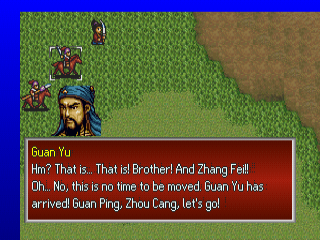
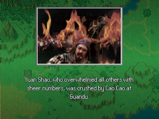
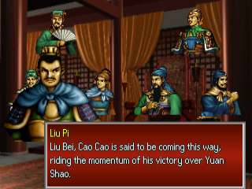
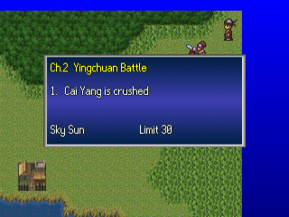
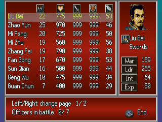
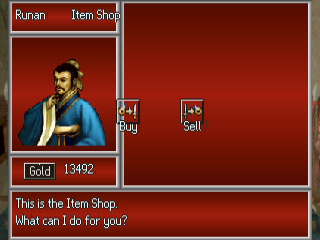
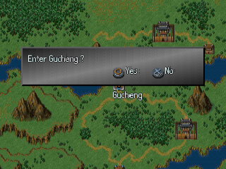
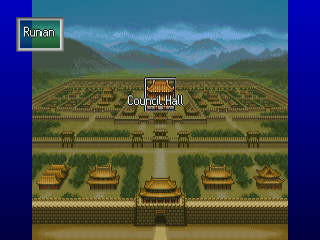
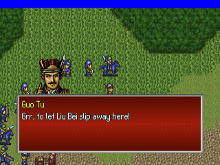

# Sangokushi Eiketsuden — English Translation

A fan translation of **Sangokushi Eiketsuden** (三國志英傑伝, Koei, 1996) for the PlayStation into
English. Unlike Koei's *Romance of the Three Kingdoms* strategy games, this is a story-driven
tactics game: you follow Liu Bei chapter by chapter, from the coalition against Dong Zhuo to the
final struggle between Shu and Wei, with hex-map battles, councils in camp, towns and shops in
between. The game was only released in Japan.

> **This is a full machine translation.** All of the game's text was translated from
> Japanese by an AI model, not by a human translator, and it has not been
> proofread by a fluent Japanese speaker. Expect occasional mistranslations, awkward
> phrasing and inconsistent terms. Corrections are welcome.

> **This is a beta.** All of the game's text is in English, but only the prologue, chapter 1 and the
> first section of chapter 2 (up to the arrival in Xiangyang) have been played in order. The opening
> scenes of the later sections, a few later battles and one ending were only checked by jumping to
> them. Expect some text that is squeezed, cut short or wrapped oddly later on.

This repository contains the English text and the tools that build the patch.
It does **not** contain the game, any of its data, or the Japanese script — you need
your own copy of the game.

## Screenshots

| | | |
|:-:|:-:|:-:|
|  |  |  |
| Event dialogue | Chapter narration | Council |
|  |  |  |
| Battle objectives | Formation and officer stats | Item shop |
|  |  |  |
| World map | Town | Battle dialogue |

## What's translated

- All event text: every chapter's dialogue, narration, chapter titles and choices
- Town people's lines
- Officer, unit type, item and strategy names and descriptions, town and battle names
- Menus, battle messages, shop and settings screens and the memory card messages
- Graphics: the stat labels, drawn at build time with an original English font; the big text on
  title cards and maps, drawn by the game at run time
- A proportional English font (original drawings) with word wrap and paging

Long labels are shortened where the game's boxes are too small.

## Applying the patch (players)

1. Download the release zip (`Sangokushi_Eiketsuden_English_v<version>.zip`) from the Releases
   page. It contains the patch `sangokushi_eiketsuden_en_v<version>.xdelta`, a `.cue` file and
   a README.txt.
2. You need an unmodified image of the Japanese disc (serial `SLPS-00309`) in the usual two-track
   BIN/CUE form. Only track 1 is patched:

   | Track 1 | |
   |---|---|
   | Size  | 303,170,448 bytes |
   | CRC32 | `2A3A50BB` |
   | MD5   | `9df7ecacbe48a833a4cb251c086aeed0` |
   | SHA-1 | `41cc9ffb7b30ceb965bae0a6e6b7d02ab954dba2` |

   Track 2 (CD audio, 37,810,752 bytes, CRC32 `40E86050`) is used unchanged.
3. Apply the patch to track 1 with an xdelta tool, e.g.
   [Delta Patcher](https://github.com/marco-calautti/DeltaPatcher) or the command line:

   ```
   xdelta3 -d -s "Sangokushi Eiketsuden (Japan) (Track 1).bin" sangokushi_eiketsuden_en_v<version>.xdelta "Sangokushi Eiketsuden (English v<version>) (Track 1).bin"
   ```

4. Put the zip's `Sangokushi Eiketsuden (English v<version>).cue` next to the patched track 1
   and the original track 2, and open the `.cue` in your emulator.

## Building from source

Requirements: Python 3.10+, `xdelta3` (for the patch file).

```
python -m venv .venv
.venv/bin/pip install -r requirements.txt
cp "/path/to/Sangokushi Eiketsuden (Japan) (Track 1).bin" sangokushi_eiketsuden_track1.bin
cp "/path/to/Sangokushi Eiketsuden (Japan) (Track 2).bin" sangokushi_eiketsuden_track2.bin
.venv/bin/python tools/setup.py      # checks the disc, extracts script/ from it
.venv/bin/python tools/build.py      # writes build/sangokushi_eiketsuden_en_track1.bin (+ track 2, .cue) and the .xdelta
```

`script/`, `extract/` and `build/` hold data from your disc and are never committed.
`.venv/bin/python tools/package.py <version>` then writes the release zip to `release/`.
No disc data is ever packaged.

## Repository layout

| Path | Contents |
|---|---|
| `tl/evm/` | English for the event text `MSG/EVM*.EVM` and the town lines `SNDT/NPC*.MES`, by entry number |
| `tl/names/` | Officer, item, strategy and town names |
| `tl/progstr/` | English for strings in the game program, by address |
| `tools/setup.py`, `tools/build.py` | Check the disc and extract; build the patched disc and the patch |
| `tools/tl.py`, `tools/text.py`, `tools/evm.py` | Translation checks, wrapping and paging; event file format |
| `tools/iso.py`, `tools/arc.py` | Disc image; graphics archive and its compression |
| `tools/names.py`, `tools/progstr.py`, `tools/fmtlimit.py` | Name tokens; program strings; format-string limits |
| `tools/vwf.py`, `tools/pixfont.py`, `tools/asm.py` | Proportional font, layout patches; small MIPS assembler |
| `tools/gfx.py` | Redrawn label graphics |
| `tools/package.py` | Makes the release zip |
| `tools/dev/`, `tools/emu/` | Development helpers (disassembly, DuckStation automation) |
| `docs/screenshots/` | README screenshots |

## Known issues

- The title logo, the loading screen art and the movies are unchanged; the duel movies keep their
  Japanese captions.
- The Armor and Weapon plates read "Arm" and "Wpn" because the plates are too small.
- The widest names touch the level icon in the unit panel.
- Most of the game after the first section of chapter 2 has not been seen in play, including most later battles, and the other
  endings have only been checked by a length test. Their text may overflow in places.

Tested in DuckStation only. Bug reports with a screenshot and where it happened are welcome.

## Credits

- Translation and hacking: [damon-daemon](https://github.com/damon-daemon)
- Sangokushi Eiketsuden © Koei Tecmo. This is an unofficial fan project, not affiliated with
  or endorsed by Koei Tecmo. Please support the official releases.

## License

The tools, fonts, documentation and English translation text in this repository
are released under the [MIT License](LICENSE). This covers only original work in
this repository: the game itself and all of its content (code, Japanese text,
graphics, audio) are copyright Koei Tecmo and are not included or licensed here.
